# HackSandbox — Writeup completo

> ⚠️ **Spoilers.** Aquí están las diez soluciones paso a paso. Si aún no has intentado los retos, empieza por [la sandbox](https://unfantasmaenelsistema.github.io/HackSandbox/) y usa las pistas de cada reto antes de leer esto.

Writeup de [Un Fantasma en el Sistema](https://www.unfantasmaenelsistema.com). Todas las salidas de consola que aparecen aquí son las reales: se obtuvieron resolviendo los retos con un navegador automatizado (Chromium) contra la propia sandbox, y las capturas salen de esa misma ejecución.

## Índice

| # | Reto | Técnica | Nivel |
|---|---|---|---|
| 1 | [El enigma de Base64](#reto-1--el-enigma-de-base64) | Codificación | Fácil |
| 2 | [El secreto del inspector](#reto-2--el-secreto-del-inspector) | HTML / DOM | Fácil |
| 3 | [El puzzle de la consola](#reto-3--el-puzzle-de-la-consola) | Consola · ROT13 | Fácil |
| 4 | [El código escondido en la URL](#reto-4--el-código-escondido-en-la-url) | Parámetros URL | Fácil |
| 5 | [El secreto de las cookies](#reto-5--el-secreto-de-las-cookies) | Cookies | Media |
| 6 | [El misterio del CSS oculto](#reto-6--el-misterio-del-css-oculto) | CSS | Fácil |
| 7 | [La ofuscación de JavaScript](#reto-7--la-ofuscación-de-javascript) | JavaScript | Media |
| 8 | [El puzzle binario](#reto-8--el-puzzle-binario) | Binario | Media |
| 9 | [El cifrado Vigenère](#reto-9--el-cifrado-vigenère) | Criptografía clásica | Media |
| 10 | [La caja fuerte del cliente](#reto-10--la-caja-fuerte-del-cliente) | Lógica en el cliente | Media |

Al final hay una [tabla con las diez flags](#resumen-de-flags) y una explicación de [cómo se comprueban](#cómo-comprueba-la-sandbox-las-flags).

---

## Antes de empezar: las herramientas

Todo se resuelve con las **herramientas de desarrollador** que trae cualquier navegador. No hace falta instalar nada.

| Acción | Chrome / Edge | Firefox |
|---|---|---|
| Abrir las herramientas | `F12` o `Ctrl+Mayús+I` | `F12` o `Ctrl+Mayús+I` |
| Ver el código fuente | `Ctrl+U` | `Ctrl+U` |
| Ir a la consola | `Ctrl+Mayús+J` | `Ctrl+Mayús+K` |
| Ver el HTML en vivo | pestaña **Elementos** | pestaña **Inspector** |
| Ver los scripts | pestaña **Fuentes** | pestaña **Depurador** |
| Ver las cookies | **Aplicación → Cookies** | **Almacenamiento → Cookies** |

En macOS: `Cmd+Opción+I` abre las herramientas, `Cmd+Opción+J` la consola de Chrome (`Cmd+Opción+K` en Firefox) y `Cmd+Opción+U` el código fuente.

> **Pegar en la consola.** La primera vez, Chrome no deja pegar código en la consola y pide escribir `allow pasting` (en español, `permitir pegar`). Es una protección contra el *self-XSS*: nunca pegues en la consola código que te mande un desconocido.

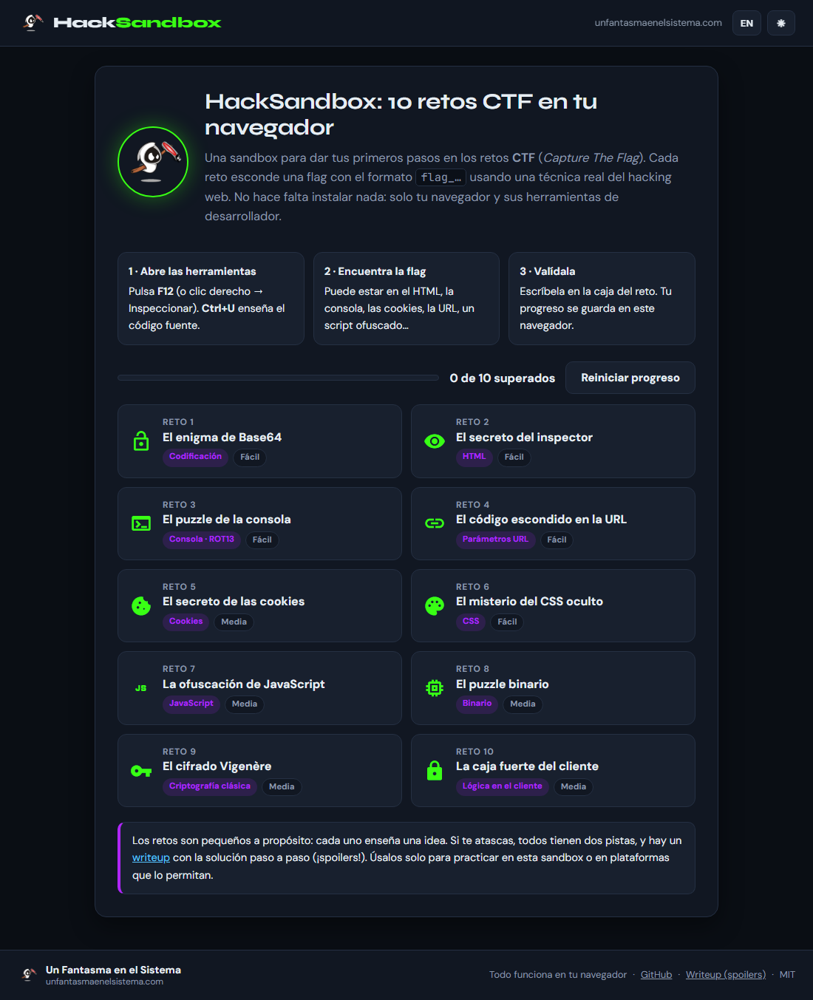

---

## Reto 1 — El enigma de Base64

**Objetivo:** descodificar un mensaje interceptado.

### Reconocimiento

La página muestra esta cadena:

```
TGEgZmxhZyBlczogZmxhZ19iYXNlNjRfbm9fZXNfY2lmcmFkbw==
```

Tres detalles delatan que es **Base64**:

1. Solo usa letras mayúsculas y minúsculas, cifras, `+` y `/` (el alfabeto de Base64 tiene exactamente 64 símbolos).
2. Termina en `==`. Base64 convierte cada 3 bytes en 4 caracteres; cuando al final sobran 1 o 2 bytes, rellena con `=` o `==`.
3. La longitud es múltiplo de 4 (aquí, 52 caracteres).

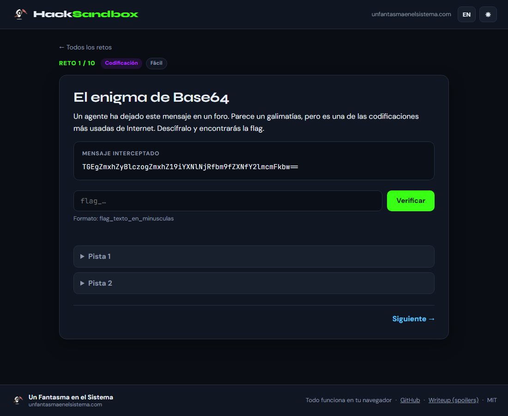

### Resolución

**Con la consola del navegador** (`F12` → Consola), la función `atob()` (*ASCII to binary*) descodifica Base64:

```js
atob('TGEgZmxhZyBlczogZmxhZ19iYXNlNjRfbm9fZXNfY2lmcmFkbw==')
```
```
'La flag es: flag_base64_no_es_cifrado'
```

**Con una terminal** (Linux, macOS o Git Bash en Windows):

```bash
echo 'TGEgZmxhZyBlczogZmxhZ19iYXNlNjRfbm9fZXNfY2lmcmFkbw==' | base64 -d
```

**Con CyberChef:** receta *From Base64*.

> Si cambias la sandbox a inglés (botón **EN**), la cadena es distinta porque el texto está en inglés (`The flag is: …`), pero la flag es la misma.

Al escribir la flag aparece el mensaje de acierto y el recuadro **Qué has aprendido**:

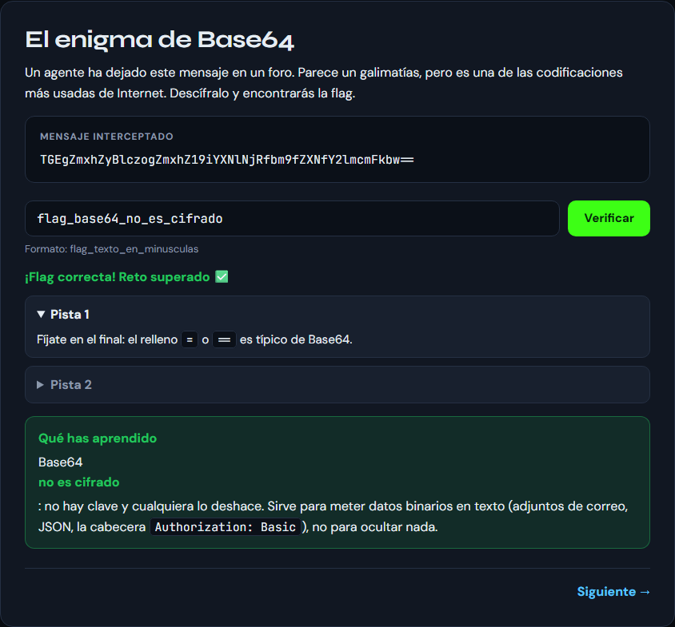

### Por qué funciona y qué aprender

Base64 **no es cifrado**: no usa clave y cualquiera lo deshace. Es una *codificación* para transportar bytes por canales que solo admiten texto (adjuntos de correo, JSON, la cabecera HTTP `Authorization: Basic`). Cuando en una auditoría veas Base64, descodifícalo siempre: es muy habitual encontrar usuarios, contraseñas o tokens «escondidos» así.

**Flag:** `flag_base64_no_es_cifrado`

---

## Reto 2 — El secreto del inspector

**Objetivo:** encontrar un elemento que la página oculta con CSS.

### Reconocimiento

La página solo dice «Aquí no hay nada que ver… 👀». Pero lo que ves es lo que el navegador **dibuja**, no todo lo que ha **recibido**.

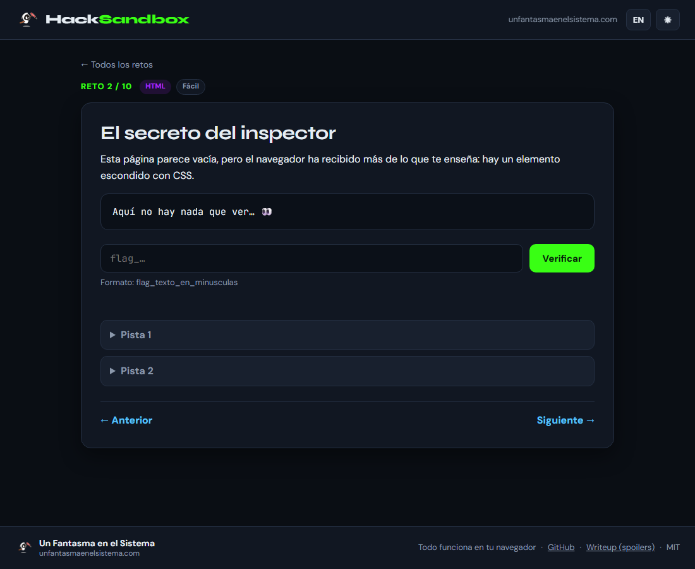

### Resolución

**Opción A — Elementos / Inspector.** Abre `F12` → **Elementos** (Chrome) o **Inspector** (Firefox) y despliega el `<article>`. Debajo del texto visible hay un `div` atenuado (las herramientas atenúan los elementos que no se ven):

```html
<div class="hidden-flag" style="display: none;">
  <p>🔒 flag: flag_el_inspector_lo_ve_todo</p>
</div>
```

Si haces doble clic sobre `display: none;` y lo borras (o desmarcas la casilla de esa propiedad en el panel **Estilos**), el elemento aparece en la página:

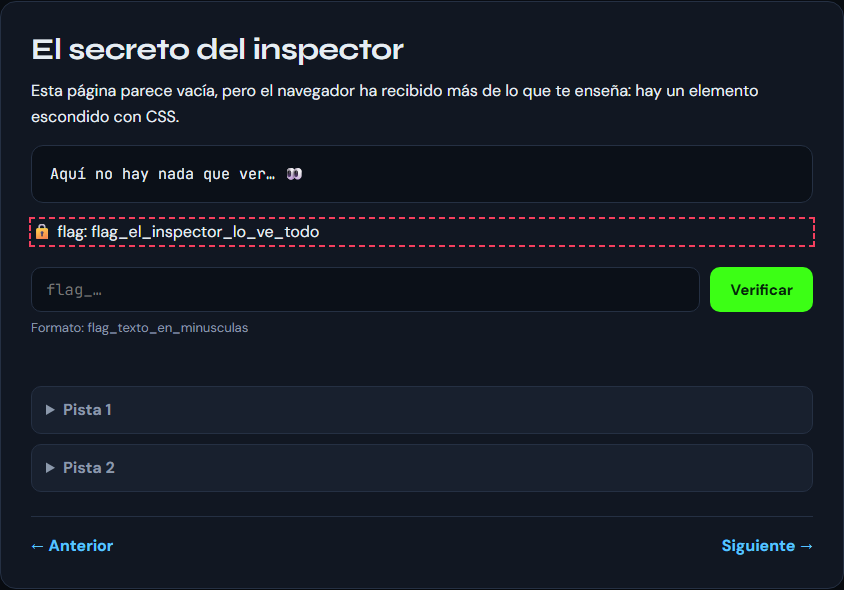

**Opción B — Código fuente.** `Ctrl+U` abre el HTML tal como llegó del servidor; busca `hidden` con `Ctrl+F`.

**Opción C — Consola:**

```js
document.querySelector('.hidden-flag').outerHTML
```
```
'<div class="hidden-flag" style="display: none;">\n      <p>🔒 flag: flag_el_inspector_lo_ve_todo</p>\n    </div>'
```

### Por qué funciona y qué aprender

`display: none` solo le dice al navegador «no lo pintes». El HTML completo viaja hasta el cliente, y cualquiera puede leerlo. En aplicaciones reales se ven a menudo campos ocultos con IDs internos, precios, roles o funciones de administración «escondidas» con CSS: lo primero en un pentest web es leer el HTML entero.

**Flag:** `flag_el_inspector_lo_ve_todo`

---

## Reto 3 — El puzzle de la consola

**Objetivo:** leer un mensaje que la página escribe en la consola y descifrarlo.

### Reconocimiento

La página pide mirar la consola. Al abrirla (`F12` → **Consola**) aparece esto, escrito por el script del reto al cargar:

```
👻 HackSandbox · Reto 3
¡Bienvenido! El mensaje secreto está cifrado con ROT13:
  Yn synt rf: synt_ebg13_ra_yn_pbafbyn
Está guardado en la variable mensajeSecreto y la función rot13() ya está cargada.
Pruébala: rot13(mensajeSecreto)
```

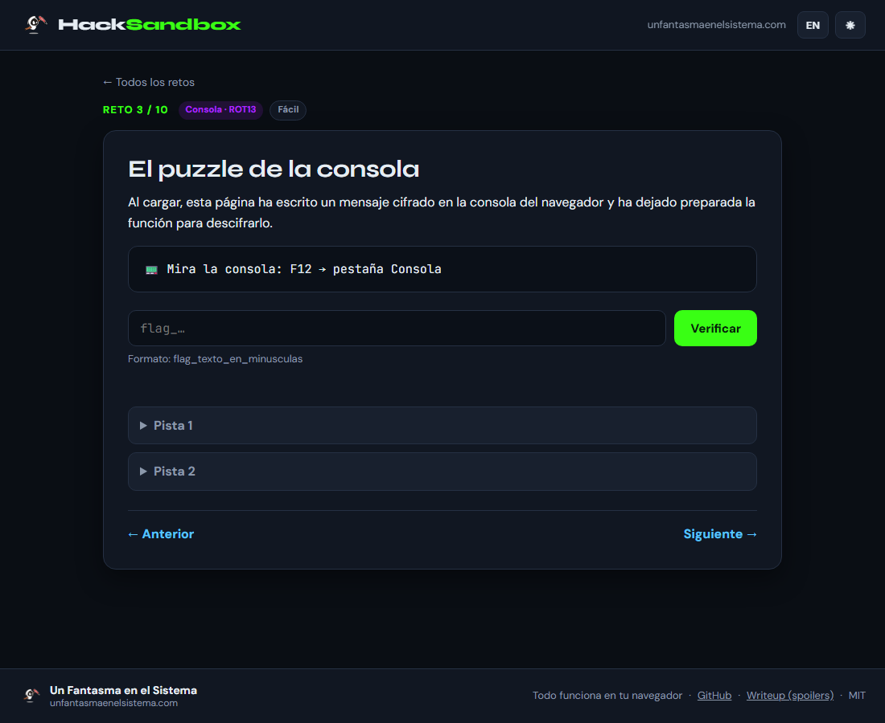

> Si abres la consola **después** de cargar la página, Chrome ya muestra los mensajes. Si no ves nada, recarga con la consola abierta.

### Resolución

ROT13 desplaza cada letra 13 posiciones en el alfabeto (`a→n`, `b→o`… `n→a`). Como el alfabeto inglés tiene 26 letras, aplicarlo dos veces devuelve el original: la misma función cifra y descifra. Los números y símbolos no cambian.

La página ha dejado la función cargada, así que basta con llamarla:

```js
rot13(mensajeSecreto)
```
```
'La flag es: flag_rot13_en_la_consola'
```

Puedes comprobarlo a mano con la primera palabra: `synt` → `s+13=f`, `y+13=l`, `n+13=a`, `t+13=g` → `flag`.

Alternativas: CyberChef (receta *ROT13*) o, en una terminal, `echo 'synt_ebg13_ra_yn_pbafbyn' | tr 'A-Za-z' 'N-ZA-Mn-za-m'`.

### Por qué funciona y qué aprender

La consola ejecuta JavaScript **dentro de la página**: ves sus variables globales (`mensajeSecreto`) y puedes llamar a sus funciones (`rot13`). Es la herramienta más potente del navegador para un atacante y la que más se usa en los retos siguientes. ROT13, por su parte, es un cifrado César con desplazamiento fijo: sirve para no leer un *spoiler* sin querer, nunca para proteger datos.

**Flag:** `flag_rot13_en_la_consola`

---

## Reto 4 — El código escondido en la URL

**Objetivo:** convertirte en administrador cambiando la dirección de la página.

### Reconocimiento

Al entrar, la página añade un parámetro a la URL y te trata como invitado:

```
http://…/HackSandbox/reto4.html?rol=invitado
```

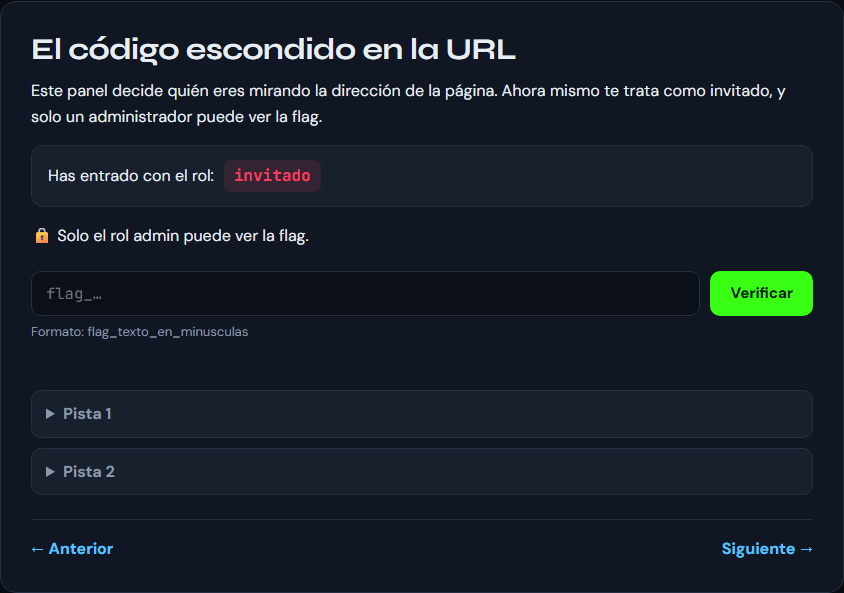

Todo lo que va después de `?` es la **query string**: pares `nombre=valor` que viajan en la URL y que el usuario puede escribir como quiera.

### Resolución

Cambia `invitado` por `admin` en la barra de direcciones y pulsa Intro:

```
http://…/HackSandbox/reto4.html?rol=admin
```

La página lee el parámetro, te da por administrador y muestra la flag:

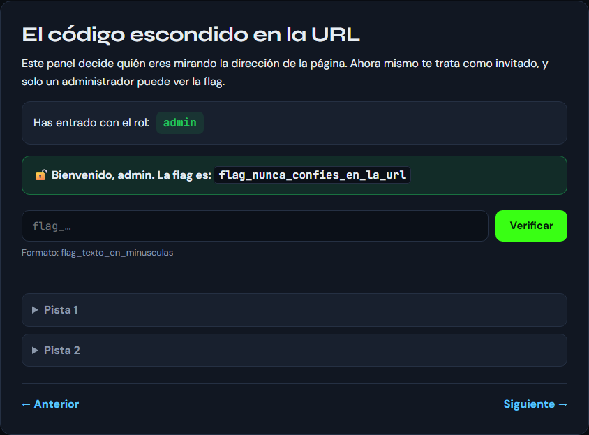

**Ruta alternativa (leyendo el código).** En `js/reto4.js` se ve la comprobación y la flag guardada al revés y en Base64:

```js
var _d = '==AbyV3Xhx2XuV2XzVWam52bj9VYj5Wdu91ZhxmZ';
// …
if (rol === 'admin') { … atob(_d.split('').reverse().join('')) … }
```

Ejecutar `atob(_d.split('').reverse().join(''))` en la consola también da la flag. En un CTF de cliente, la flag siempre está en algún sitio del navegador; aquí la vía prevista es la URL, pero leer el código es igual de válido.

### Por qué funciona y qué aprender

Es un fallo de **control de acceso roto** (OWASP Top 10, A01): la aplicación decide los permisos con un dato que controla el usuario. En la vida real aparece como `?admin=true`, `?debug=1`, `?user_id=124` (IDOR) o campos ocultos de formularios. Los permisos siempre se comprueban **en el servidor**, a partir de la sesión autenticada.

**Flag:** `flag_nunca_confies_en_la_url`

---

## Reto 5 — El secreto de las cookies

**Objetivo:** hacerte administrador editando una cookie.

### Reconocimiento

La página dice que eres un usuario normal y muestra el valor de la cookie `es_admin`:

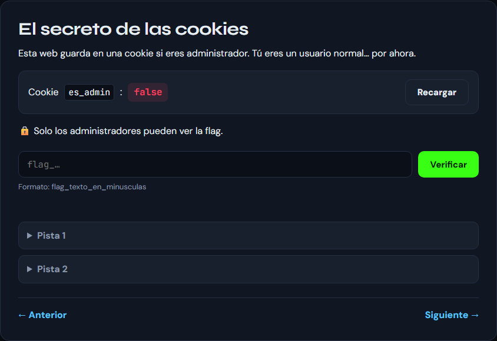

En la consola puedes ver todas las cookies de la página:

```js
document.cookie
```
```
'es_admin=false'
```

### Resolución

**Opción A — Panel de cookies.** `F12` → **Aplicación** (Chrome) o **Almacenamiento** (Firefox) → **Cookies** → el origen de la página. Haz doble clic en el valor `false` de `es_admin`, escribe `true`, pulsa Intro y recarga la página (`F5` o el botón **Recargar**).

**Opción B — Consola:**

```js
document.cookie = "es_admin=true"
document.cookie
```
```
'es_admin=true'
```

Después recarga. Al cargar, el script lee la cookie, ve `true` y te muestra la flag:

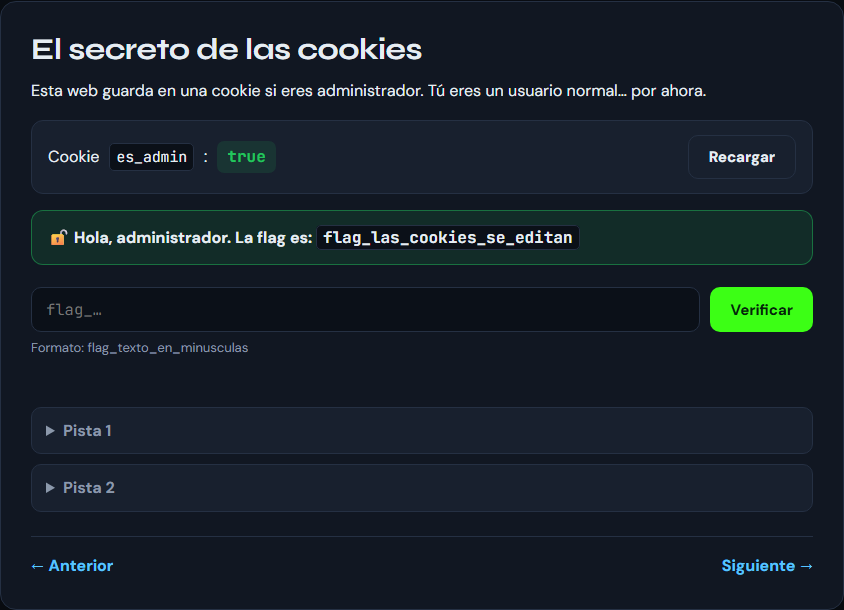

> **Ojo con la ruta.** Una cookie se identifica por nombre **y** ruta (`path`). La sandbox crea `es_admin` con la ruta de la carpeta de la página, y `document.cookie = "es_admin=true"` sin `path` usa esa misma ruta por defecto, así que la sustituye. Si escribieras `path=/` crearías una segunda cookie distinta con el mismo nombre.

**Ruta alternativa:** igual que en el reto 4, `js/reto5.js` guarda la flag al revés y en Base64 en la variable `_d`.

### Por qué funciona y qué aprender

Las cookies viven en el navegador del usuario, que puede leerlas y cambiarlas. Guardar en ellas **decisiones de autorización sin firmar** (`es_admin=true`, `rol=user`, `precio=10`) permite escalar privilegios con dos clics. Una sesión segura guarda solo un identificador aleatorio largo (y el servidor busca los permisos con él) o un token firmado, como un JWT bien validado, que el cliente no puede alterar sin invalidar la firma. Y las cookies de sesión llevan `HttpOnly`, para que JavaScript ni siquiera pueda leerlas.

**Flag:** `flag_las_cookies_se_editan`

---

## Reto 6 — El misterio del CSS oculto

**Objetivo:** encontrar una nota que el diseñador dejó en la hoja de estilos.

### Reconocimiento

En pantalla solo hay una pista: «🎨 Los estilos también pueden guardar secretos.».

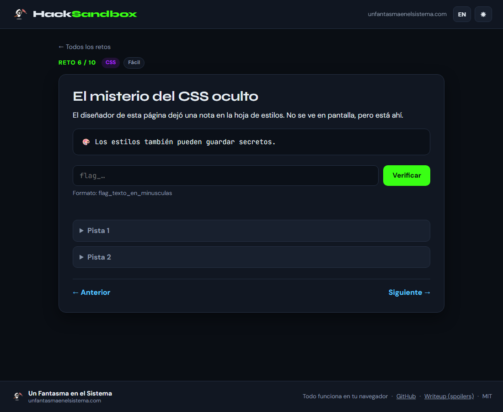

Curiosidad: ese texto **tampoco está en el HTML**. Lo pinta el CSS con `content: attr(data-txt)` en un pseudoelemento `::after`, una técnica habitual para iconos y adornos.

### Resolución

Pulsa `Ctrl+U` y mira el bloque `<style>` de la cabecera (`<head>`). Dentro hay un comentario de CSS, que va entre `/*` y `*/` y que el navegador ignora al dibujar:

```css
/* TODO: quitar antes de publicar.
   flag_el_css_tambien_habla */
.pista-css::after { content: attr(data-txt); }
```

También lo encuentras en `F12` → **Elementos**, desplegando `<head>` → `<style>`.

### Por qué funciona y qué aprender

Los comentarios de HTML, CSS y JavaScript se envían al navegador tal cual: solo los quita una herramienta de *minificación*, si se usa. Revisarlos es parte básica del **reconocimiento**: en auditorías reales aparecen rutas de administración, nombres de servidores internos, credenciales de prueba y notas del tipo `TODO: quitar antes de publicar` que nadie quitó.

**Flag:** `flag_el_css_tambien_habla`

---

## Reto 7 — La ofuscación de JavaScript

**Objetivo:** extraer una flag de un script ofuscado.

### Reconocimiento

La página señala el script `js/reto7.js`. Ábrelo en `F12` → **Fuentes** (Chrome) o **Depurador** (Firefox):

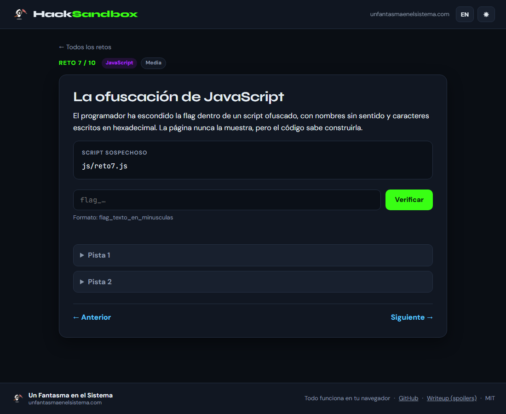

```js
var _0x5e1d = ['\x5f\x70\x72\x6f\x74\x65\x67\x65\x72', '\x63\x61\x72\x5f\x6e\x6f\x5f\x65\x73', '\x66\x6c\x61\x67\x5f\x6f\x66\x75\x73'];
var _0x9a01 = ['\x4e\x61\x64\x61\x20\x71\x75\x65\x20\x76\x65\x72', '\x41\x63\x63\x65\x73\x6f\x20\x64\x65\x6e\x65\x67\x61\x64\x6f'];
function _0x2b7c() { return _0x5e1d['\x73\x6c\x69\x63\x65']()['\x72\x65\x76\x65\x72\x73\x65']()['\x6a\x6f\x69\x6e'](''); }
function _0x7f3e(_0x1) { return _0x9a01[_0x1 % _0x9a01['\x6c\x65\x6e\x67\x74\x68']]; }
var _0x44aa = _0x7f3e(0x1);
```

Es el estilo típico de los ofuscadores automáticos:

- **Nombres sin sentido** (`_0x5e1d`, `_0x2b7c`) en lugar de nombres descriptivos.
- **Cadenas en hexadecimal**: `\x66` es el carácter con código 0x66 = 102 = `f`.
- **Métodos escritos como cadenas**: `x['\x73\x6c\x69\x63\x65']()` es lo mismo que `x['slice']()`, o sea, `x.slice()`.
- **Código de relleno** que no lleva a nada (`_0x9a01`, `_0x7f3e`, `_0x44aa`), para despistar.

### Resolución

No hace falta traducir el hexadecimal a mano: el propio navegador lo hace. Escribe el nombre del array en la consola:

```js
_0x5e1d
```
```
['_proteger', 'car_no_es', 'flag_ofus']
```

La función `_0x2b7c` hace `slice()` (copia), `reverse()` (invierte) y `join('')` (une sin separador). Invertido queda `['flag_ofus', 'car_no_es', '_proteger']`, y unido:

```js
_0x2b7c()
```
```
'flag_ofuscar_no_es_proteger'
```

Para scripts más largos existen *desofuscadores* y *embellecedores* (el botón `{}` de **Fuentes** formatea el código minificado).

### Por qué funciona y qué aprender

Ofuscar **no es proteger**: el navegador tiene que poder ejecutar el código, así que quien lo ejecuta también puede leerlo. La ofuscación solo hace el análisis más lento. Cualquier secreto que llegue al cliente (claves de API, credenciales, lógica de licencias) está expuesto, por muy ofuscado que esté. Los secretos se quedan en el servidor.

**Flag:** `flag_ofuscar_no_es_proteger`

---

## Reto 8 — El puzzle binario

**Objetivo:** descodificar un mensaje en binario escondido en el código fuente.

### Reconocimiento

La página solo da una pista: «💾 8 bits = 1 carácter».

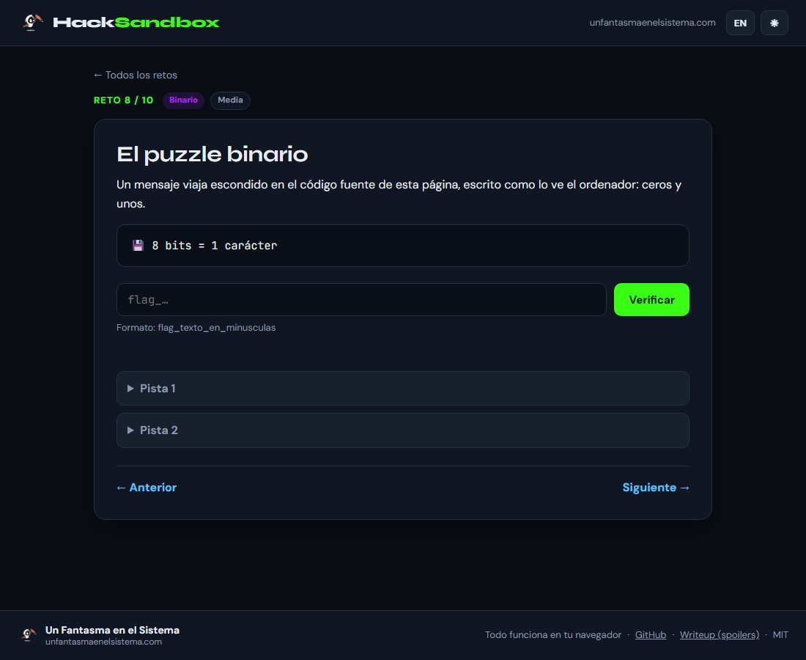

Con `Ctrl+U` aparece, justo encima de esa pista, un comentario HTML (entre `<!--` y `-->`) que no se ve en pantalla:

```html
<!-- 01100110 01101100 01100001 01100111 01011111 01100010 01101001 01101110 01100001 01110010 01101001 01101111 01011111 00111000 01011111 01100010 01101001 01110100 01110011 -->
```

### Resolución

Son 19 grupos de 8 bits (bytes). Cada byte es el código ASCII de un carácter. El primero, a mano:

```
0 1 1 0 0 1 1 0
↓ ↓ ↓ ↓ ↓ ↓ ↓ ↓
0·128 + 1·64 + 1·32 + 0·16 + 0·8 + 1·4 + 1·2 + 0·1 = 102 → 'f'
```

Para los 19 a la vez, en la consola:

```js
'01100110 01101100 01100001 01100111 01011111 01100010 01101001 01101110 01100001 01110010 01101001 01101111 01011111 00111000 01011111 01100010 01101001 01110100 01110011'
  .split(' ')
  .map(b => String.fromCharCode(parseInt(b, 2)))
  .join('')
```
```
'flag_binario_8_bits'
```

`parseInt(b, 2)` lee el texto como un número en base 2 y `String.fromCharCode` lo convierte en su carácter. En CyberChef: receta *From Binary*.

### Por qué funciona y qué aprender

Binario, hexadecimal, decimal y Base64 son **formas distintas de escribir los mismos bytes**. En un CTF ahorra mucho tiempo reconocerlas a simple vista: solo `0` y `1` en grupos de 8 → binario; `0-9a-f` por parejas → hexadecimal; terminado en `=` → Base64. Y, como en el reto 6, los comentarios HTML llegan al navegador aunque no se vean.

**Flag:** `flag_binario_8_bits`

---

## Reto 9 — El cifrado Vigenère

**Objetivo:** descifrar un mensaje con Vigenère encontrando la clave.

### Reconocimiento

La página muestra el mensaje cifrado:

```
Qa seay qs: klnz_vaseseex_cgz_cqaix
```

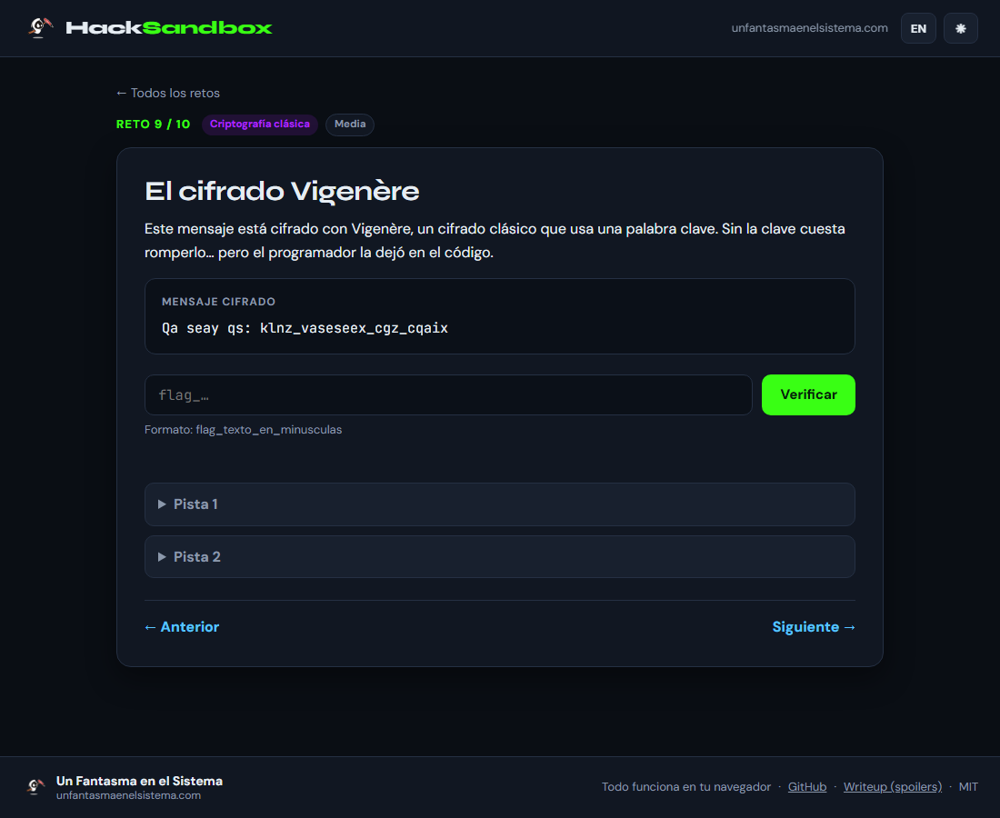

Se conserva la estructura (espacios, `:` y `_` en su sitio), así que es un **cifrado de sustitución** letra a letra. Pero no es César: la palabra `flag` debería aparecer dos veces cifrada igual y no es así (`seay`, `klnz`). Eso indica un cifrado **polialfabético** como Vigenère, que usa una palabra clave para cambiar el desplazamiento en cada letra.

### Resolución

**1. Buscar la clave.** En `F12` → **Fuentes** → `js/reto9.js`, la primera línea:

```js
var clave = 'fantasma';
```

**2. Descifrar.** El script trae la función `descifrarVigenere(texto, clave)`. En la consola:

```js
descifrarVigenere('Qa seay qs: klnz_vaseseex_cgz_cqaix', clave)
```
```
'La flag es: flag_vigenere_con_clave'
```

**Cómo funciona por dentro.** Cada letra de la clave es un desplazamiento (`a`=0, `b`=1… `f`=5). Para descifrar se resta. La clave solo avanza con las letras; los espacios y símbolos se copian igual:

| Cifrado | Q | a | s | e | a | y |
|---|---|---|---|---|---|---|
| Clave | f (5) | a (0) | n (13) | t (19) | a (0) | s (18) |
| Q−5, a−0… | **L** | **a** | **f** | **l** | **a** | **g** |

(Las letras `s`, `e`, `a` e `y` de `seay` se descifran con `n`, `t`, `a` y `s`: el espacio no consume clave.)

### Por qué funciona y qué aprender

El **principio de Kerckhoffs** dice que un sistema de cifrado debe ser seguro aunque el atacante conozca todo menos la clave. Aquí el algoritmo es público y la clave está en el código del cliente, así que no hay seguridad ninguna. Y aunque la clave no estuviera, Vigenère se rompe con análisis de frecuencias: el **método de Kasiski** busca repeticiones en el texto cifrado para deducir la longitud de la clave, y después cada posición es un César que se resuelve por separado.

**Flag:** `flag_vigenere_con_clave`

---

## Reto 10 — La caja fuerte del cliente

**Objetivo:** abrir una «caja fuerte» que se protege con una variable de JavaScript.

### Reconocimiento

Al pulsar **Abrir la caja fuerte** sale «acceso denegado»:

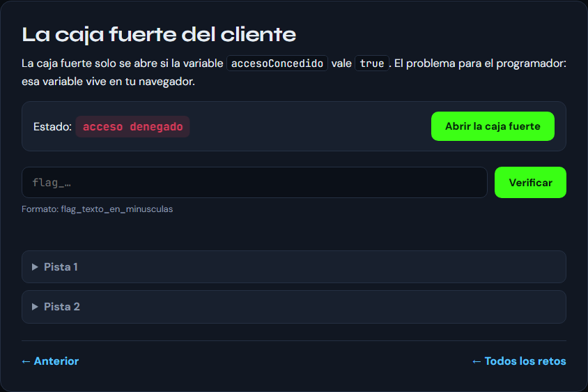

En `js/reto10.js` se ve la lógica:

```js
var accesoConcedido = false;

function abrirCajaFuerte() {
  if (accesoConcedido === true) {
    // … muestra la flag …
  } else {
    // … "acceso denegado" …
  }
}
```

La decisión depende de una **variable global** del navegador. Las variables declaradas con `var` fuera de una función pasan a ser propiedades de `window` y se pueden cambiar desde la consola.

### Resolución

**Opción A — Consola.** Cambia la variable y vuelve a pulsar el botón:

```js
accesoConcedido = true
```

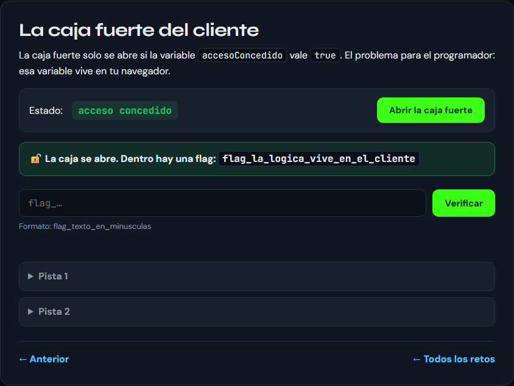

**Opción B — Punto de interrupción.** En **Fuentes**, haz clic en el número de línea del `if (accesoConcedido === true)` para poner un *breakpoint*. Al pulsar el botón, la ejecución se detiene ahí; en la consola (que ahora trabaja en ese punto) escribe `accesoConcedido = true` y pulsa ▶ para continuar.

**Ruta alternativa (leer el código).** La flag está en el array `_c`, cada carácter combinado con 42 mediante XOR. Como `(x ^ 42) ^ 42 = x`, se recupera así:

```js
_c.map(x => String.fromCharCode(x ^ 42)).join('')
```
```
'flag_la_logica_vive_en_el_cliente'
```

### Por qué funciona y qué aprender

Toda comprobación hecha en el navegador se puede saltar: variables, condiciones, botones deshabilitados, validaciones de formularios, límites de intentos… **El cliente es territorio del atacante.** Las validaciones en JavaScript mejoran la experiencia de uso, pero las decisiones de seguridad (quién puede hacer qué) se toman y se repiten en el servidor.

**Flag:** `flag_la_logica_vive_en_el_cliente`

---

## Resumen de flags

| # | Flag | Dónde estaba |
|---|---|---|
| 1 | `flag_base64_no_es_cifrado` | Texto en Base64 en la página |
| 2 | `flag_el_inspector_lo_ve_todo` | `div` con `display: none` |
| 3 | `flag_rot13_en_la_consola` | Mensaje ROT13 en la consola |
| 4 | `flag_nunca_confies_en_la_url` | Se muestra con `?rol=admin` |
| 5 | `flag_las_cookies_se_editan` | Se muestra con la cookie `es_admin=true` |
| 6 | `flag_el_css_tambien_habla` | Comentario en el `<style>` |
| 7 | `flag_ofuscar_no_es_proteger` | Array hexadecimal de `js/reto7.js` |
| 8 | `flag_binario_8_bits` | Comentario HTML en binario |
| 9 | `flag_vigenere_con_clave` | Vigenère con la clave de `js/reto9.js` |
| 10 | `flag_la_logica_vive_en_el_cliente` | Variable `accesoConcedido` |

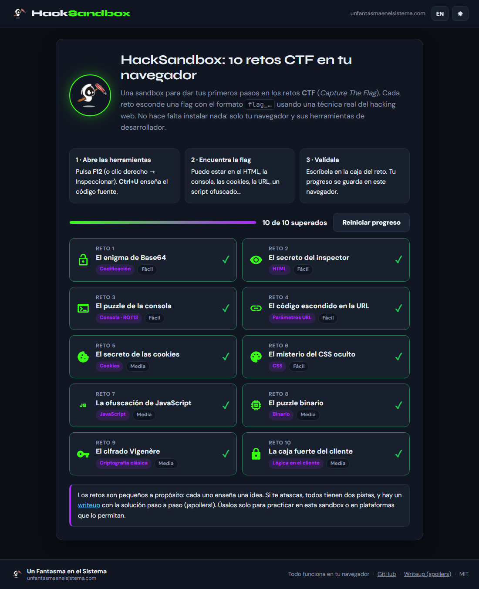

## Cómo comprueba la sandbox las flags

El archivo común `assets/hs.js` **no contiene las flags**, solo su huella SHA-256:

```js
var HASHES = {
  1: '1e32ecd9dd81da81e3ed553ab2cad6c2032adc2b3a13af26728475f900f6a98a',
  // …
};
```

Al pulsar **Verificar**, la sandbox calcula el SHA-256 de lo que has escrito y lo compara. Un hash no se puede «deshacer», así que leer ese archivo no te ahorra resolver los retos. Lo puedes comprobar tú en una terminal:

```bash
printf '%s' 'flag_base64_no_es_cifrado' | sha256sum
```
```
1e32ecd9dd81da81e3ed553ab2cad6c2032adc2b3a13af26728475f900f6a98a  -
```

Aun así, en los retos 4, 5, 7 y 10 la flag tiene que estar en el cliente de alguna forma, porque la página te la enseña. Por eso esos retos admiten también la vía de «leer el código», como se explica en cada uno. Es la misma lección de fondo de toda la sandbox: **lo que llega al navegador, lo puede leer quien lo usa.**

---

*HackSandbox · [Un Fantasma en el Sistema](https://www.unfantasmaenelsistema.com) · Licencia MIT.*
